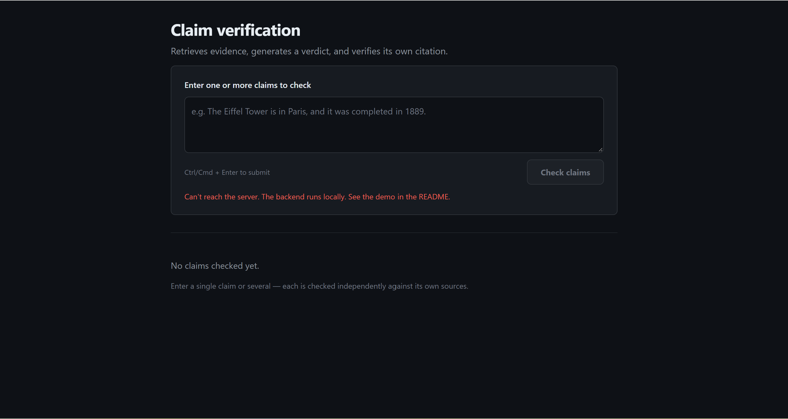

# Claim Verification System

A retrieval-augmented tool that checks natural-language claims against Wikipedia. For each claim it retrieves evidence, asks an LLM for a verdict (**TRUE / FALSE / MISLEADING / UNKNOWN**) with an explanation and an exact supporting quote, then programmatically checks that the quote really appears in the retrieved text.

Built from scratch (no LangChain / LangGraph) as a learning project on free tools: Groq API, local embeddings, FAISS, spaCy, FastAPI, and a React + TypeScript frontend.

> **Status:** the backend runs locally. It loads an embedding model and spaCy into memory, which needs more RAM than free hosting tiers offer. The frontend is hosted on GitHub Pages, but it can only show the interface because it has no backend to call. The demo below shows the full system running.

## Demo

**Frontend on GitHub Pages:** https://prasanna7777.github.io/rag-based-claim-verification-system/ *(interface only; submitting a claim shows "can't reach the server" because the backend runs locally. See the recording below for the full system.)*


| Misleading | Unverifiable | Multi-claim | Error state |
|---|---|---|---|
|  |  |  |  |

Responsive layout (phone width): 

## What it does

A plain LLM asked "is this true?" answers from memory, with no way to check its reasoning. This system instead:

1. Splits the input into independent claims
2. Finds the best-matching Wikipedia article for each claim
3. Retrieves the most relevant passages from that article
4. Generates a verdict grounded in those passages, with a verbatim quote
5. Checks the quote exists in the retrieved evidence, and downgrades the verdict to UNKNOWN if it does not

### Verdicts

| Verdict | Meaning |
|---|---|
| TRUE | The evidence supports the claim |
| FALSE | The evidence contradicts the claim, or the claimed item is missing from an exhaustive list in the evidence |
| MISLEADING | The evidence partly supports the claim, but the claim overstates or omits key context |
| UNKNOWN | The evidence is insufficient, or the quote could not be verified |

## How it works

```
User input
   |
   v
Claim splitter (LLM)               splits multi-claim input into standalone claims
   |
   v
Entity extraction (spaCy NER)      finds the main entities in each claim
   |
   v
Wikipedia search                   opensearch title match, full-text search as fallback
   |
   v
Title picker (LLM)                 chooses the best candidate article
   |
   v
Section-aware retrieval            1) embed each section, keep the top 2
   |                               2) split those into paragraph chunks
   |                               3) FAISS top-3 chunks vs. the claim
   v                               (falls back to flat retrieval if nothing is found)
Verdict generation (LLM)           verdict + explanation + supporting quote
   |
   v
Citation verification              normalized substring match, then stopword-filtered
   |                               word-overlap fallback (threshold 0.75)
   v
Response: verdict, explanation, quote, citation status, source link
```

### Design decisions

- **Claim splitting first.** "The Eiffel Tower is in Paris, and Einstein was born in Germany" becomes two claims, each verified against its own evidence.
- **Section-aware retrieval.** Wikipedia articles are long, and one relevant sentence can be buried among unrelated paragraphs. The system first scores whole sections (using the article's own structure), then chunks and searches only inside the top ones. It is designed to cut noise from irrelevant parts of the article.
- **Citation verification.** The LLM must quote its evidence verbatim. A check confirms the quote appears in the retrieved text; the word-overlap fallback ignores stopwords so filler words cannot inflate a match. This catches fabricated quotes, but it only proves the quote *exists* in the evidence, not that it *supports* the verdict.
- **Abstention.** If evidence is insufficient or the citation fails verification, the result is UNKNOWN rather than a forced answer.
- **Date-aware prompt.** The current date is given to the model so claims like "still ongoing" can be checked against dates in the evidence.
- **Absence reasoning.** Absence from an exhaustive list (a full discography, a roster) counts as evidence for FALSE. Absence from incidental prose (a general biography) is treated as insufficient evidence.

## Tech stack

| Component | Choice |
|---|---|
| LLM (splitting, title picking, verdicts) | Groq API, `openai/gpt-oss-120b` (free tier) |
| Embeddings | `BAAI/bge-small-en-v1.5` via sentence-transformers (local) |
| Vector search | FAISS |
| Entity extraction | spaCy (`en_core_web_trf`, falls back to `en_core_web_sm`) |
| Evidence source | English Wikipedia (opensearch + search API) |
| Backend | FastAPI |
| Frontend | React + TypeScript (Vite) |

## Run locally

Requires Python 3.11, Node 18+, and a free [Groq API key](https://console.groq.com/).

```powershell
# backend
conda create -n claimcheck python=3.11 -y
conda activate claimcheck

# torch: pick ONE (GPU build shown first; use the CPU build if you have no NVIDIA GPU)
pip install torch --index-url https://download.pytorch.org/whl/cu124
# pip install torch --index-url https://download.pytorch.org/whl/cpu

pip install -r requirements.txt
python -m spacy download en_core_web_sm
# optional, better entity extraction (heavier):
# python -m spacy download en_core_web_trf
```

Create a `.env` file in the project root:

```
GROQ_API_KEY=your_key_here
```

Start the backend:

```powershell
python -m uvicorn app.main:app --reload --port 8000
```

Start the frontend in a second terminal:

```powershell
cd frontend
npm install
npm run dev
```

Open the URL Vite prints (usually http://localhost:5173).